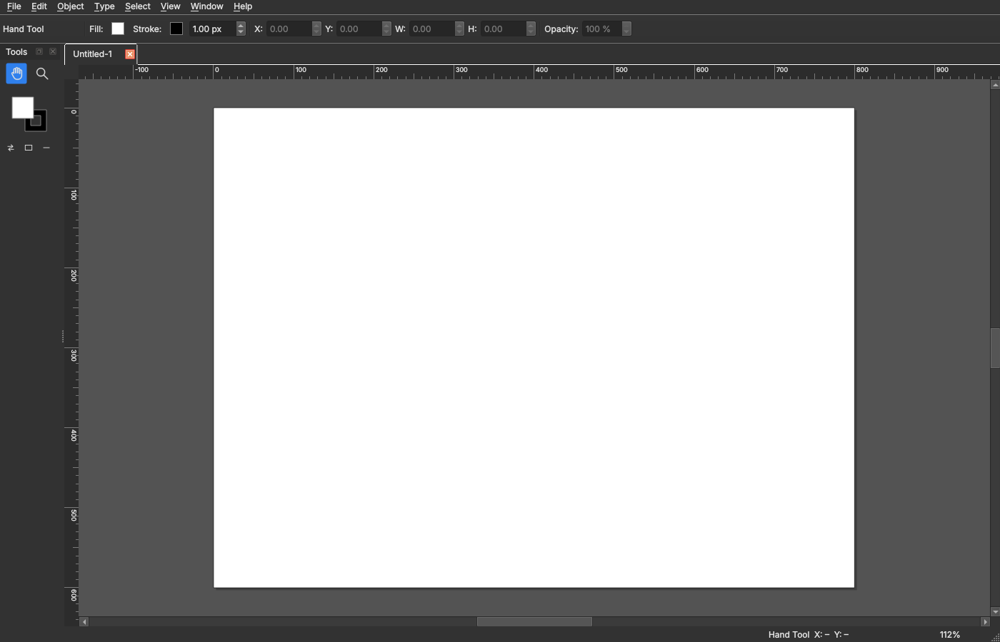

# MegaPencil

MegaPencil is a desktop vector graphics editor for Ubuntu 22.04+ written in Python with Qt 6
(PySide6). SVG is its native file format. It is an original, independent project and makes no
network connections at runtime.



## Requirements

- Python 3.11 or newer
- PySide6 (Qt 6) and pyclipper
- On a minimal Ubuntu install Qt also needs a few system libraries:

```bash
sudo apt install libegl1 libgl1 libxkbcommon0 libfontconfig1 libdbus-1-3
```

## Run from a checkout

```bash
python3 -m venv .venv
```

```bash
. .venv/bin/activate
```

```bash
pip install -e ".[dev]"
```

```bash
python -m megapencil
```

Open files by passing them on the command line: `python -m megapencil drawing.svg`.

## Tests

```bash
QT_QPA_PLATFORM=offscreen python -m pytest
```

Headless screenshot of the main window (also a startup smoke test):

```bash
QT_QPA_PLATFORM=offscreen python tests/screenshot.py out.png
```

## Status

The build follows the milestones in [docs/PLAN.md](docs/PLAN.md).

| # | Milestone | State |
|---|-----------|-------|
| 1 | Window shell, artboard, rulers and guides, zoom, pan, dark/light theme | done |
| 2 | Shape tools (rectangle, ellipse, line) | not started |
| 3 | Selection tool | not started |
| 4 | Pen and Direct Selection tools | not started |
| 5 | Layers panel, arrange | model and menu commands done, panel not started |
| 6 | Group, align/distribute, duplicate, copy/paste | model and menu commands done, Align panel not started |
| 7 | Undo/redo | command framework done and used by every existing edit |
| 8 | Text tool | model done, tool not started |
| 9 | SVG open/save, PNG/PDF export, autosave | implemented; only SVG round-trip is tested so far |
| 10 | Boolean path operations, gradients | model done, gradient editor not started |
| 11 | Preferences, recent files, shortcut list | implemented, lightly tested |
| 12 | Packaging (.desktop, .deb) | not started |

## Layout of the code

- `src/megapencil/model/` – the document model. Pure Python, no Qt, tested without a GUI.
- `src/megapencil/commands.py` – undo commands; every edit goes through a `QUndoStack`.
- `src/megapencil/ui/` – Qt widgets: canvas (`scene.py`, `view.py`, `rulers.py`), tools, panels,
  main window.

## Licence

MIT
