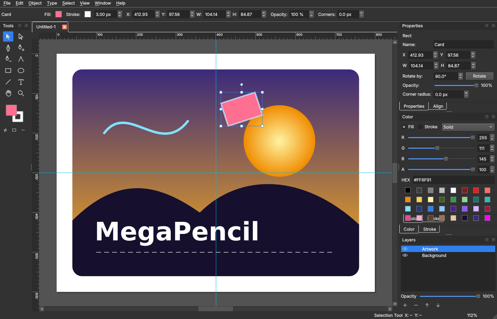

# MegaPencil

MegaPencil is a desktop vector graphics editor for Ubuntu 22.04+ written in Python with Qt 6
(PySide6). SVG is its native file format. It is an original, independent project and makes no
network connections at runtime.



## Download

Get **MegaPencil-x86_64.AppImage** from the
[latest release](https://github.com/mmcvey02/megapencil/releases/latest): one file for Ubuntu
22.04+ on x86-64 with everything inside. Mark it executable once (right-click ▸ Properties ▸
"Executable as Program"), then double-click it.

Releases are built by `.github/workflows/release.yml`: run it from the Actions tab (Release ▸ Run
workflow) or push a `v*` tag.

## Requirements

- Python 3.11 or newer
- PySide6 (Qt 6) and pyclipper
- On a minimal Ubuntu install Qt also needs a few system libraries:

```bash
sudo apt install libegl1 libgl1 libxkbcommon0 libfontconfig1 libdbus-1-3
```

## Run from a checkout

```bash
python3 -m venv .venv
```

```bash
. .venv/bin/activate
```

```bash
pip install -e ".[dev]"
```

```bash
python -m megapencil
```

Open files by passing them on the command line: `python -m megapencil drawing.svg`.

## Tests

```bash
QT_QPA_PLATFORM=offscreen python -m pytest
```

Headless screenshot of the main window with a sample drawing (also a startup smoke test):

```bash
QT_QPA_PLATFORM=offscreen python tests/screenshot.py out.png
```

## Features

- **Workspace** – menu bar, context-sensitive control bar, dockable two-column toolbox, tabbed
  documents with an artboard on a pasteboard, rulers with drag-out guides, dockable Properties,
  Align, Color, Stroke and Layers panels, status bar (zoom, cursor position, active tool), dark
  and light themes.
- **Tools** – Selection (V), Direct Selection (A), Pen (P), Add Anchor (+), Delete Anchor (-),
  Convert Anchor (Shift+C), Rectangle (M), Ellipse (L), Line (\), Text (T), Hand (H), Zoom (Z).
  Fill/stroke swatches with swap (Shift+X), default (D) and none (/).
- **Editing** – move, scale and rotate with handles, arrow-key nudge, group/ungroup,
  align/distribute, arrange, duplicate, copy/paste between documents, lock/hide, per-layer
  visibility, lock and opacity. Every edit is undoable.
- **Paths** – Bézier pen with corner and smooth points, anchor and handle editing, add/delete/
  convert anchors, boolean union / subtract / intersect / exclude, text to outlines.
- **Paint** – solid colours with alpha, linear and radial gradients with any number of stops,
  stroke weight, caps, joins and dashes.
- **Files** – open and save SVG (layers are Inkscape-compatible groups), export PNG and PDF at a
  chosen scale, autosave with crash recovery, recent files, preferences.

Help ▸ Keyboard Shortcuts (F1) lists every shortcut.

## Single-file application (AppImage)

```bash
packaging/build_appimage.sh
```

This produces `dist/MegaPencil-0.1.0-x86_64.AppImage`: one file containing MegaPencil, its own
Python interpreter, Qt and pyclipper. Nothing needs to be installed on the target machine
(Ubuntu 22.04 or newer, x86-64). Double-click it to start; pass SVG files as arguments to open
them. If your file manager does not start it, mark it executable once (right-click ▸ Properties ▸
"Executable as Program"), or:

```bash
chmod +x MegaPencil-0.1.0-x86_64.AppImage
```

The build script downloads a relocatable CPython (python-build-standalone) and appimagetool from
GitHub, and a few small X11 helper libraries with `apt-get download`; the built application
itself never uses the network. On systems without FUSE, run it with
`--appimage-extract-and-run`.

## Install as a .deb

```bash
packaging/build_deb.sh
```

```bash
sudo apt install ./dist/megapencil_0.1.0_amd64.deb
```

The package bundles MegaPencil, PySide6-Essentials and pyclipper under `/opt/megapencil`, adds a
`megapencil` command, the application-menu entry (`packaging/megapencil.desktop`) and the icon.
It depends on the Python minor version it was built with, so build it on the Ubuntu release you
install it on. Ubuntu 22.04 ships Python 3.10; install Python 3.11+ first and build with
`PYTHON=python3.11 packaging/build_deb.sh`.

## Known limits

- Transforms never scale strokes. Files are written with `vector-effect="non-scaling-stroke"`;
  SVGs from other programs have their stroke widths converted on import.
- Boolean operations flatten curves to short line segments (0.05 px tolerance), so results are
  polygons with corner anchors. Open paths are treated as closed.
- Group opacity is applied to each member, so overlapping members of a semi-transparent group
  show through each other.
- Text is point text only (no text boxes or text on a path). Multi-line text uses a fixed 1.2
  line height.
- Gradients are positioned relative to the object's bounding box; `gradientTransform` in
  imported files is ignored.
- SVG import skips images, `<use>`, clipping paths, masks, patterns and CSS style sheets.
- All paths use the non-zero fill rule.
- The Layers panel lists layers, not the objects inside them.
- Rendering uses Qt's software rasteriser: with 5,000 objects in view a full redraw (zoom, pan,
  or dragging hundreds of objects at once) takes roughly 70–100 ms, while hover feedback,
  marquees and dragging up to 300 objects take about 1 ms per frame.

## Layout of the code

- `src/megapencil/model/` – the document model. Pure Python, no Qt, tested without a GUI.
- `src/megapencil/commands.py` – undo commands; every edit goes through a `QUndoStack`.
- `src/megapencil/ui/` – Qt widgets: canvas (`scene.py`, `view.py`, `rulers.py`), tools, panels,
  main window.
- `tests/` – pytest suite: model, path math, SVG round-trip, undo, and headless GUI tests for
  every tool and panel, plus a 5,000-object performance test.
- `packaging/` – `.desktop` entry, AppImage and `.deb` build scripts.

## Licence

MIT
